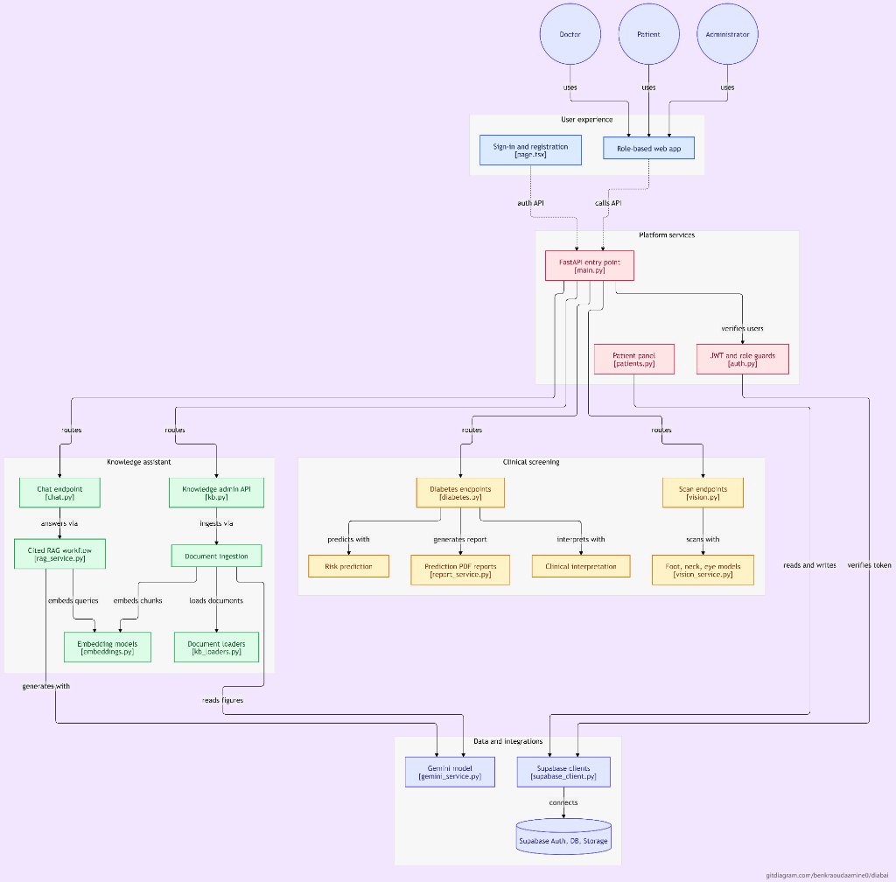
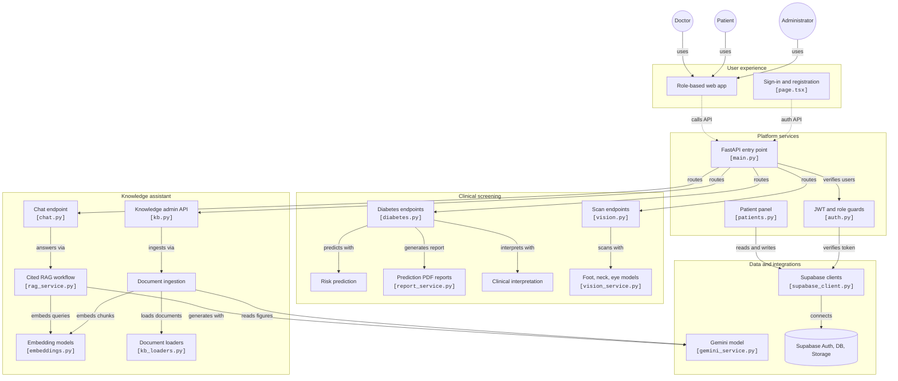

# DiabAI — AI-Powered Diabetes Screening & Care Platform

---

## 1. Project Name & One-Line Summary

**DiabAI** is an AI-powered clinical screening platform helping doctors detect diabetes early and screen complications alongside patient self-checks.

---

## 2. Project Description

Over 537 million adults live with diabetes, with more than 40% undiagnosed until severe complications like diabetic foot ulcers or retinopathy occur. General practitioners lack rapid, explainable risk tools, while patients struggle with early self-detection.

DiabAI provides a collaborative clinical screening platform for healthcare providers and patients. Doctors assess metabolic risk via an XGBoost model with SHAP factor explanations and Gemini clinical summaries, validate official reports, and grade complications. Patients perform visual checks for foot ulcers and acanthosis nigricans using computer vision models and ask an evidence-grounded RAG assistant citing clinical guidelines. Doctor-validated reviews guarantee clinical safety before patients see predictions.

Designed for clinicians, endocrinologists, and individuals at risk of diabetes.

---

## 3. Live Demo Link & Credentials

- **Live Application URL:** [https://diab-ai.vercel.app](https://diabai.vercel.app) *(or local demo at `http://localhost:3000`)*
- **API Status & Health Check:** [https://diabai-9iy5.onrender.com/api/health](https://diabai-9iy5.onrender.com/api/health)
- **Computer Vision Inference (Hugging Face ZeroGPU):** [https://huggingface.co/spaces/BenkraoudaAmine/diabai-vision](https://huggingface.co/spaces/BenkraoudaAmine/diabai-vision)

> **Note on cold starts:** Because of how the backend is hosted (Render), it goes to sleep when idle. The first request can take **1–2 minutes** while the server wakes up. The AI models (risk prediction and the Hugging Face ZeroGPU vision models) can also take **about a minute** to load on first use. After that, responses are fast.

### Demo Accounts for Evaluators

| Role              | Email                       | Password               | Notes                                                                                |
| :---------------- | :-------------------------- | :--------------------- | :----------------------------------------------------------------------------------- |
| **Doctor**  | `doctor.demo@diabai.com`  | `DiabAIDoctor2026!`  | Access to ML risk predictor, SHAP analysis, patient panel, reports & eye scan        |
| **Patient** | `patient.demo@diabai.com` | `DiabAIPatient2026!` | Access to foot ulcer photo check, RAG medical assistant & confirmed records          |
| **Admin**   | `admin.demo@diabai.com`   | `DiabAIAdmin2026!`   | Access to system metrics, token usage costs, security audits & knowledge base ingest |

*(Evaluators can also self-register as Doctor or Patient directly from the landing page).*

---

## 4. Code Repository

- **Public GitHub Repository:** [https://github.com/BenkraoudaAmine0/DiabAI](https://github.com/BenkraoudaAmine0/DiabAI)

---

## 5. Demo Video

- **Video Walkthrough (YouTube / Google Drive):** [Watch DiabAI Demo Video](https://drive.google.com/drive/folders/1YadfmvTskZxQA6iu-qity7yRKLGqHXzr?usp=sharing) *(3-minute full clinical workflow demonstration: doctor prediction, SHAP waterfall, Gemini interpretation, PDF export, patient foot ulcer check, and grounded RAG chatbot).*

---

## 6. Team Members & Roles

- **Neila Djakour**: Medical student; came up with the project idea.
- **Mohamed Amine Benkraouda** (`BenkraoudaAmine0`): Project manager; trained the AI models, built the API core and deployed the app.
- **Abdelhak Hamzi** (`abdelhak0999`): Full-stack developer; built the frontend, the backend and the foot photo screening with doctor review.
- **Fatima Kassouar**: UI/UX designer; designed the app's interface.

---

## 7. Tech Stack & AI Tools Used

### Languages & Frameworks

- **Frontend:** Next.js 16 (App Router), React 19, TypeScript, Tailwind CSS v4, Lucide Icons
- **Backend:** Python 3.11, FastAPI, Pydantic v2, Uvicorn, ReportLab (bilingual clinical PDF generation)

### Machine Learning & Computer Vision

- **Tabular Risk Prediction:** XGBoost classifier with custom decision threshold (0.395) tuned to minimize false negatives on prediabetic and diabetic patient cohorts.
- **Explainability:** SHAP (TreeExplainer) generating feature importance and patient-specific waterfall attribution plots.
- **Vision Models:** ResNet50 / CNN models exported to ONNX format for diabetic foot ulcer detection and retinopathy classification.
- **Vision Inference Hosting:** Dedicated Hugging Face Space running on ZeroGPU (`BenkraoudaAmine/diabai-vision`) via `gradio_client` to avoid memory limits.

### Generative AI & RAG

- **LLM:** Google Gemini (`gemini-3.5-flash-lite`) via Google GenAI SDK for clinical interpretations and grounded medical answers.
- **Embeddings:** Google `gemini-embedding-001` (API) & FastEmbed (`embeddinggemma-300m`, local CPU).
- **RAG Orchestration:** LangChain & LangGraph (condense query → pgvector cosine retrieval → citation generation with chapter/page metadata).
- **Multimodal Document Parsing:** PyMuPDF, python-docx, and ebooklib with Gemini image OCR for tables, charts, and scanned textbook pages.

### Database, Auth & Infrastructure

- **Database & Auth:** Supabase (PostgreSQL with `pgvector` HNSW index, Row Level Security, Supabase Auth with JWT verification, Storage buckets, Realtime websocket alerts).
- **Hosting:** Vercel (Frontend), Render (FastAPI Backend), Hugging Face Spaces (GPU Vision).

### AI Pair-Programming Tools

- Heavily utilized **Google Antigravity**, **Claude Code**, and   **ZCode** for architectural prototyping, SQL migration hardening, automated test scenarios, and debugging deployment environments.

---

## 8. What Happens Next (3-Month Roadmap)

Over the next three months, we will pilot DiabAI with local Algerian health clinics to validate diagnostic accuracy on real patient cohorts. We plan to integrate offline-capable mobile on-device vision models (ONNX Runtime / TFLite) for rural clinics with intermittent connectivity. We will expand retinopathy grading to full 5-stage clinical classification with certified ophthalmologist benchmarks, secure health data privacy compliance, and enable automated laboratory EHR sync (HL7/FHIR) for direct bloodwork ingestion.

*(71 words)*

---

## System Architecture



<details>
<summary><b>Click to view interactive Mermaid flowchart</b></summary>



</details>

---

## Project Structure

```
DiabAI/
├── backend/
│   ├── app/
│   │   ├── main.py                  FastAPI entrypoint (+ /api/health check)
│   │   ├── config.py                Pydantic settings (.env management)
│   │   ├── auth.py                  Supabase JWT verification + role guards
│   │   ├── schemas.py               Request & response models
│   │   ├── routers/
│   │   │   ├── diabetes.py          Risk prediction, SHAP waterfall, validation, PDF
│   │   │   ├── vision.py            POST /api/scan/{foot|neck|eye}
│   │   │   ├── patients.py          Doctor panel CRUD & patient onboarding
│   │   │   ├── records.py           GET /api/records/me (patient medical history)
│   │   │   ├── chat.py              POST /api/chat (grounded RAG with citations)
│   │   │   ├── admin.py             GET /api/admin/{stats,users,health}
│   │   │   ├── admin_security.py    Security audit logs, failed logins, IP tracking
│   │   │   └── kb.py                KB document upload/list/delete/re-index
│   │   └── services/
│   │       ├── supabase_client.py   Anon (Auth) + Service-Role (DB/Storage) clients
│   │       ├── diabetes_service.py  XGBoost + scaler + threshold + SHAP + tiers
│   │       ├── vision_service.py    Hugging Face ZeroGPU / local ONNX loader
│   │       ├── gemini_service.py    Gemini LLM client (summaries & vision OCR)
│   │       ├── rag_service.py       LangGraph workflow: condense → retrieve → generate
│   │       ├── interpretation_service.py Clinical AI interpretation
│   │       ├── report_service.py    Bilingual medical PDF report (ReportLab)
│   │       ├── kb_loaders.py        PDF/DOCX/EPUB/TXT/MD extractors
│   │       ├── kb_ingest_service.py Chunker → embeddings → pgvector storage
│   │       └── kb_vectorstore.py    SupabaseVectorStore adapter for kb_chunks
│   ├── models_app/                  Model artifacts (XGBoost, scaler, threshold, SHAP)
│   ├── knowledge_base/              Seed diabetes clinical guidelines
│   ├── scripts/
│   │   ├── check_setup.py           Full read-only environment verification
│   │   ├── download_models.py       Downloads models from Hugging Face Hub
│   │   ├── ingest_kb.py             CLI knowledge base ingestion
│   │   └── verify_diabetes.py       Replays test scenarios against clinical logic
│   └── supabase/migrations/         0001 through 0013 SQL migrations
├── frontend/                        Next.js 16 application
│   ├── src/
│   │   ├── app/                     App Router pages (Doctor, Patient, Admin, Auth)
│   │   ├── components/              Reusable UI (WorkspaceShell, Charts, Scans)
│   │   ├── contexts/                Auth, Language (EN/FR), and Notification contexts
│   │   └── lib/                     Supabase client and utility helpers
├── docs/                            ROLES.md · RAG_ARCHITECTURE.md
├── datasets/                        diabetes_prediction_dataset.csv (training data)
└── models/                          Training notebooks & raw model exports
```

---

## Local Setup & Installation

### Step 1: Clone Repository

```bash
git clone https://github.com/BenkraoudaAmine0/DiabAI.git
cd DiabAI
```

### Step 2: Database Setup (Supabase)

1. Create a project at [supabase.com](https://supabase.com).
2. Open the **SQL Editor** in Supabase and run the migration files in `backend/supabase/migrations/` sequentially:

| Migration                        | Purpose                                                                         |
| :------------------------------- | :------------------------------------------------------------------------------ |
| `0001_init.sql`                | Core schema, RLS policies, `match_kb_chunks`, `scans` & `kb-docs` buckets |
| `0002_admin.sql`               | `gemini_usage` tracking table for token and cost management                   |
| `0003_kb_index.sql`            | HNSW vector index for pgvector similarity searches                              |
| `0004_notifications.sql`       | In-app notification triggers and Realtime publication                           |
| `0005_kb_uploads.sql`          | Upload statuses, chunk citation metadata, `match_kb_chunks_v2`                |
| `0006_kb_rich_content.sql`     | Extraction metrics (tables, charts, and OCR pages)                              |
| `0007_prediction_review.sql`   | Doctor validation flow (pending / confirmed / rejected)                         |
| `0008_role_hardening.sql`      | Role escalation prevention and automated profile synchronization                |
| `0009_embedding_model.sql`     | Multi-model embedding tagging and `match_kb_chunks_v3`                        |
| `0010_profiles_admin_role.sql` | Admin security role definitions                                                 |
| `0011_next_visit.sql`          | Patient clinical recall and appointment scheduling                              |
| `0012_patient_record.sql`      | Comprehensive patient medical history view                                      |
| `0013_admin_security.sql`      | System security audit logging and failed authentication tracking                |

3. Copy the **Project URL**, **Anon Key**, and **Service Role Key** from **Project Settings → API**.
4. In **Authentication → URL Configuration**, add `http://localhost:3000/**` to **Redirect URLs**.

### Step 3: Backend Setup

```bash
cd backend
python -m venv .venv
# On Windows:
.venv\Scripts\activate
# On Linux/macOS:
# source .venv/bin/activate

pip install -r requirements.txt
copy .env.example .env    # Linux/macOS: cp .env.example .env
```

Configure your `.env` with your Supabase credentials, Google Gemini API key, and Hugging Face settings:

```env
SUPABASE_URL=https://your-project.supabase.co
SUPABASE_ANON_KEY=your-anon-key
SUPABASE_SERVICE_ROLE_KEY=your-service-role-key
GEMINI_API_KEY=your-gemini-api-key
GEMINI_MODEL=gemini-3.5-flash-lite
EMBEDDING_PROVIDER=gemini
GEMINI_EMBEDDING_MODEL=gemini-embedding-001
HF_MODEL_REPO_ID=BenkraoudaAmine/diabai-models
```

Verify your setup:

```bash
python scripts/check_setup.py
```

Run the backend server:

```bash
uvicorn app.main:app --reload --port 8000
```

### Step 4: Knowledge Base Seed Ingestion

Populate the RAG knowledge base with the included clinical guidelines:

```bash
python scripts/ingest_kb.py
```

### Step 5: Frontend Setup

```bash
cd ../frontend
npm install
copy .env.example .env.local    # Linux/macOS: cp .env.example .env.local
```

Set your environment variables in `.env.local`:

```env
NEXT_PUBLIC_SUPABASE_URL=https://your-project.supabase.co
NEXT_PUBLIC_SUPABASE_ANON_KEY=your-anon-key
NEXT_PUBLIC_API_URL=http://localhost:8000
```

Launch the development server:

```bash
npm run dev
```

Open [http://localhost:3000](http://localhost:3000) in your browser.

---

## Clinical Workflows & How It Works

### 1. Doctor Diabetes Risk Prediction

- **Input Parameters:** 8 clinical features (`gender`, `age`, `hypertension`, `heart_disease`, `smoking_history`, `bmi`, `HbA1c_level`, `blood_glucose_level`).
- **Model Execution:** Evaluated with an XGBoost classifier with an optimized decision threshold of `0.395`. Features are scaled with the exact training pipeline parameters.
- **Prediabetic Rule Override:** Automatically flags patients with HbA1c 5.7–6.5% and fasting blood glucose 100–126 mg/dL as Prediabetic regardless of probability.
- **Explainability:** SHAP values calculate the exact positive or negative contribution of each factor, generating an annotated waterfall plot stored securely in Supabase Storage.
- **Clinical Interpretation:** Gemini synthesizes a contextual clinical summary explaining the risk factors in natural language (available in English and French).
- **Review & Validation:** Every prediction is saved as `pending`. Only once the doctor clicks **Confirm & Validate** does the prediction become visible on the patient's portal.
- **PDF Export:** Doctors and patients can export a standardized clinical report in English or French generated via ReportLab.

### 2. Computer Vision Complication Screening

- **Diabetic Foot Ulcer Detection:** Evaluates uploaded foot images to detect ulceration or pre-ulcerative lesions. Hosted on a private Hugging Face ZeroGPU space to maintain high responsiveness without backend memory bloat.
- **Retinopathy Classification:** Doctor-exclusive tool for grading fundus examination photographs.
- **Acanthosis Nigricans (Neck Check):** Visual check for cutaneous hyperpigmentation associated with severe insulin resistance.

### 3. Grounded RAG Chatbot

- **Query Condensation:** Conversational context is condensed into a standalone query using LangGraph.
- **Semantic Vector Search:** Queries are embedded using `gemini-embedding-001` and matched via cosine similarity in pgvector against pre-indexed medical textbooks and guidelines.
- **Citation Guardrails:** The response must cite authoritative passages with exact chapter and page metadata. If no verified information is found, the assistant honestly declines to answer rather than hallucinating.

---

## Honest Handling of In-Progress & Future Features

In accordance with transparent engineering principles:

1. **Acanthosis Nigricans Dataset Expansion:** The neck screening model is currently undergoing retraining with higher demographic diversity; if a weight checkpoint is unavailable, the API returns a structured 503 fallback message rather than crashing.
2. **Production SMTP:** Email invitations and password resets in development use Supabase's built-in mailer. For commercial production scale, an external SMTP provider (such as Resend or SendGrid) should be configured to prevent free-tier rate limits.
3. **Clinical Regulatory Clearance:** DiabAI is an assistive screening tool designed to augment healthcare professionals and does not replace formal medical diagnosis by a licensed physician.

---

## Documentation Links

- [Roles &amp; Permissions (Admin, Doctor, Patient)](docs/ROLES.md)
- [RAG Architecture, Vector Search &amp; Code Review](docs/RAG_ARCHITECTURE.md)
- [Hugging Face Models Repository](https://huggingface.co/BenkraoudaAmine/diabai-models)
- [Hugging Face Vision Space (ZeroGPU)](https://huggingface.co/spaces/BenkraoudaAmine/diabai-vision)

---

## License

This project is licensed under the MIT License — see the [LICENSE](LICENSE) file for details.
