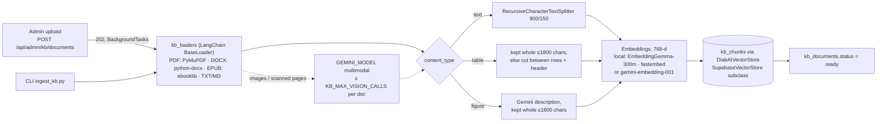
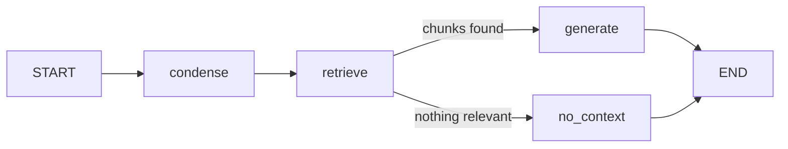

# DiabAI — RAG architecture & code review

Status of the knowledge-base pipeline (ingestion) and the chatbot (retrieval
+ generation) after the October 2026 review, what was verified, and what is
still open. Roles and the admin upload workflow: see [ROLES.md](ROLES.md).

## Architecture

Two pipelines share one vector store (`kb_chunks`, pgvector 768-d, HNSW).
Both are built from **LangChain** components; the chat flow is orchestrated
by a **LangGraph** `StateGraph`.

### 1. Ingestion — admin upload or `scripts/ingest_kb.py`

| Step     | Code                                         | Notes                                                                                     |
| -------- | -------------------------------------------- | ----------------------------------------------------------------------------------------- |
| Validate | `routers/kb.py`, `kb_ingest_service.check_*` | extension + magic bytes, size limit, SHA-256 duplicate guard                              |
| Load     | `services/kb_loaders.py`                     | `PdfLoader`, `DocxLoader`, `EpubLoader` — text, tables (Markdown), figures, scanned pages |
| Split    | `kb_ingest_service.split`                    | per page / chapter / section, so every chunk has an exact citation                       |
| Embed    | `services/embeddings.py`                     | `EMBEDDING_PROVIDER`: local EmbeddingGemma (default) or Gemini; batches of 50, retry on 429 / 5xx; model recorded per document |
| Store    | `services/kb_vectorstore.py`                 | maps LangChain metadata to the real columns; page, chapter, `content_type` → `metadata` jsonb |
| Status   | `kb_documents.status`, `extraction`          | `processing → ready \| failed`; only `ready` documents are searchable                     |

### 2. Chat — `POST /api/chat`

| Node         | What it does                                                                                                                                                     |
| ------------ | ---------------------------------------------------------------------------------------------------------------------------------------------------------------- |
| `condense`   | LCEL `prompt \| Gemini \| StrOutputParser` rewrites a follow-up ("and for children?") into a standalone search query using the last 6 messages. Skipped on the first question. |
| `retrieve`   | question embedded by the knowledge base's model → `DiabAIVectorStore.similarity_search` → `match_kb_chunks_v3` RPC (documents of that model only), top 5, optional `KB_MIN_SIMILARITY` |
| `generate`   | system rules + conversation history + numbered context (tables keep their rows) → answer citing `[n]`                                                            |
| `no_context` | fixed reply in the user's language — the model never answers without sources                                                                                    |

Every LLM call goes through `GeminiUsageCallback` → `gemini_usage` (admin
cost view). The graph is in `app/services/rag_service.py` (`get_graph()`).

Why LangGraph here: the flow has a real branch (no sources → no model call)
and a conditional step (history rewrite). It stays a small, testable graph;
conversation memory comes from `chat_messages` in Supabase, so no LangGraph
checkpointer is needed.

### Embedding model: local by default

The team will index a ~1 100-page book (≈ 4 000 chunks of ~225 tokens).
Gemini's per-text limit (2 048 tokens) isn't a problem, but its **free
tier** is: 30 000 tokens/min and **1 000 requests/day**, and Google doesn't
document whether each text in a batch counts as one request — if it does,
one book takes about 4 days. Hence `EMBEDDING_PROVIDER=local` (default):

| | local (default) | gemini |
| --- | --- | --- |
| Model | `google/embeddinggemma-300m` — Google's open embedding model, 768-d, multilingual, 2 048-token input | `gemini-embedding-001`, 768-d |
| Runs | on the API server, fastembed + ONNX Runtime (no PyTorch) | Gemini API |
| 1 100-page book | ≈ 15 min (≈ 5 chunks/s, measured on the dev laptop) | days on the free tier, ≈ $0.10 paid |
| Cost / quota | free, none | per token / daily quota |
| Server needs | ~1.2 GB download once, ~1.5 GB RAM | API key |

**Rule:** the question must be embedded by the model that embedded the
documents — vectors of two models can't be compared. That's why the book
can't be embedded locally "just once" and then searched with Gemini: the
chatbot uses the same local model for every question (≈ 50 ms each).
`kb_documents.embedding_model` (migration 0009) records each document's
model, `match_kb_chunks_v3` only searches documents of the current one, and
the admin table flags the others as *Not searched — re-index*.

Measured with the model's own prefixes (`task: search result | query:` /
`title: none | text:`): a French question finds the French HbA1c passage,
an English question finds the French retinopathy passage.

Deployment note: free hosting tiers with 512 MB RAM can't hold the local
model; there, switch to `EMBEDDING_PROVIDER=gemini` (paid tier for big
books) and re-index.

### Other LLM use

- **Clinical interpretation** of a diabetes prediction
  (`services/interpretation_service.py`): one LCEL chain, reference ranges
  in the prompt, written once per language and stored on the record.
- **Image reading** during ingestion (`gemini_service.read_image`).

All use the single `GEMINI_MODEL` (no fallback, by design).

---

## Verification

| What                                                                                 | How                                                                     | Result |
| ------------------------------------------------------------------------------------ | ----------------------------------------------------------------------- | ------ |
| PDF: text, ruled table, embedded chart, scanned page, bookmarks → chapters           | generated test PDF, fake Gemini reader                                   | ✅ 1 table, 1 figure, 1 OCR page, chapters cited |
| DOCX: headings → sections, table, picture                                            | generated test DOCX                                                      | ✅ |
| EPUB: chapter, `<table>`, `` + caption                                          | generated test EPUB                                                      | ✅ |
| Vision budget / vision off / unreadable image                                        | `max_images` 1 and 0                                                     | ✅ skipped, counted, never fatal |
| Long table split                                                                     | 80-row table                                                             | ✅ 3 parts, header repeated |
| Full ingestion job (store → load → split → embed → ready), 429 retry                 | in-memory Supabase + fake embeddings                                     | ✅ |
| LangGraph: first question, follow-up rewrite, empty KB (FR reply), usage logging     | fake chat model + fake retriever                                         | ✅ follow-up searched as a standalone query; tokens logged |
| LangChain 1.x / langchain-google-genai 4.x / LangGraph 1.x APIs                      | installed versions inspected                                             | ✅ |
| Diabetes model unchanged                                                             | `scripts/verify_diabetes.py` (8 notebook scenarios)                      | ✅ same scores and tiers |
| Prediction API: predict, report, review, interpretation, PDF, access rules           | FastAPI TestClient + in-memory Supabase                                  | ✅ |
| Invitation link → set password → sign in; report page; confirm; PDF                  | browser against a local Supabase / API stand-in                          | ✅ |
| Frontend                                                                             | `tsc`, `next build`                                                      | ✅ |
| **Not verified**: real Gemini calls (model name, embeddings, vision), real Supabase (migrations 0005–0009, invite email) | needs `backend/.env` keys                       | to do with the team's project |

## Uploading books — checklist

1. Apply migrations `0005`, `0006` and `0009`.
2. Start the API once with internet access: the local embedding model
   downloads (~1.2 GB) on the first start — the log says
   `[startup] embeddings: local model ready`.
3. Either **upload** it: admin dashboard → Knowledge base → **Book** → choose
   the PDF / EPUB → Upload, and wait for *Ready* (the table shows the
   progress). Or, for a very big file, use the **command line** from
   `backend/` (no upload size limit, progress printed every 500 chunks):
   `.venv\Scripts\python.exe scripts\ingest_kb.py path\to\book.pdf --kind book`
4. Time for ~1 100 pages: reading the PDF (a few minutes) + ≈ 15 min of
   local embedding + one Gemini call per figure, up to `KB_MAX_VISION_CALLS`
   (60 by default — raise it if the book's figures matter, each call counts
   against the Gemini quota).
5. Ask the assistant something from the book: sources show
   *Title · Chapter · p. 142*, tagged *table* / *figure* when relevant.

Over 50 MB the book is still indexed, but on Supabase's free plan its
original isn't stored, so it can't be re-indexed later from the dashboard
(re-run the command line instead).

---

## Code review

### Fixed in this pass

| Severity | Finding                                                                                                                                       | Fix |
| -------- | --------------------------------------------------------------------------------------------------------------------------------------------- | --- |
| Critical | Anyone could sign up as **admin**: `handle_new_user` copied `role` from signup metadata and the check constraint allows `'admin'`             | `0008_role_hardening.sql` |
| Critical | Any user could set their own `role` (or `email`) from the browser: `profiles_update_own` allowed every column                                 | `0008` — users may only edit name, phone, birth date, sex |
| High     | Invitation links didn't log the patient in: `@supabase/ssr` is PKCE-only and rejects Supabase's implicit-flow invite links; there was no page to set a password | `/auth/callback` → `/set-password` + *Login access* resend (team lead, notifications commit); this branch adds the landing-page fallback and *Forgot password?* on that flow |
| High     | Chat had no memory: the frontend never sent `session_id` (a new session per message) and the backend never used the history                  | session reuse + LangGraph `condense` node |
| High     | Admin dashboard logged **0 tokens / $0** for every chat answer: usage was read from `llm_output["token_usage"]`, which langchain-google-genai doesn't fill | read `AIMessage.usage_metadata` |
| High     | PDF / Word tables were flattened into jumbled text, images ignored, scanned PDFs rejected                                                       | `kb_loaders.py` |
| Medium   | Long tables were split mid-row by the text splitter                                                                                           | table-aware split |
| Medium   | Question and answer rows shared one `now()` timestamp, so ordering by `created_at` was ambiguous                                               | explicit timestamps |
| Medium   | SHAP waterfall showed scaler z-scores (`−0.125 = HbA1c_level`) and a broken emoji glyph; matplotlib used from several threads                   | entered values + readable names, lock |
| Medium   | Diabetes result was shown to patients straight away, without any doctor validation                                                            | review workflow (`0007`): patients see confirmed predictions only |
| Low      | Smoking select listed "Former smoker" three times                                                                                             | one option |
| Low      | Admin scans weren't attributed to the selected patient                                                                                        | `routers/vision.py` |
| Low      | Patient scan history had no `id` (React keys)                                                                                                 | `routers/records.py` |
| Low      | Dead code: `gemini_service.generate` / `embed_text` (embedding without task type)                                                              | removed |
| Low      | `max_output_tokens=1024` could truncate answers of models that think first                                                                    | 2048 |

### Open — needs a team decision

| Severity | Finding | Recommendation |
| -------- | ------- | -------------- |
| High | Open signup: anyone can register as a **doctor**, add any patient by email (`POST /api/patients/link`) or by id (prediction / scan auto-link), then read that patient's full history | Doctor accounts approved by an admin (e.g. `profiles.verified`), and/or patient consent before linking |
| Medium | The model's probabilities are almost always ~0 % or ~100 %: in the training dataset diabetes is defined almost entirely by HbA1c ≥ 6.5 % or glucose ≥ 200, so XGBoost learned near-deterministic rules. `verify_diabetes.py`'s "P7 Moderate tier" comes out 100 % Critical | Present it as a classifier + tier (as the report now does); calibrate (`CalibratedClassifierCV`) or retrain on clinical data before calling it a "risk %" |
| Medium | `xgb_diabetes.pkl` is a pickle from an older XGBoost (warning at load); `scaler.pkl` needs scikit-learn 1.8.0 | Re-export with `model.save_model("xgb_diabetes.json")`; pin `scikit-learn==1.8.0` and `xgboost` in requirements |
| Low | `match_kb_chunks_v3` filters (`status = 'ready'`, similarity floor) after the HNSW scan, so it can return < k rows when many chunks are filtered out | fine at this size; pgvector ≥ 0.8: `set hnsw.iterative_scan = relaxed_order` |
| Low | Background tasks live in the API process (handled by `fail_interrupted`), single worker required | a job queue if many books are uploaded at once |
| Low | Every API call verifies the token with a network call to Supabase (`auth.get_user`) | verify the JWT locally (JWKS) |
| Low | `npm run lint`: 2 existing `react-hooks/set-state-in-effect` errors (`i18n/index.tsx`, `doctor/patients/page.tsx`) | small refactors |
| Info | PyMuPDF is AGPL-3.0 | fine for academic use; commercial closed-source use needs Artifex's licence or a switch to pdfplumber |
| Info | `GEMINI_MODEL=gemini-3.5-flash-lite` couldn't be checked without a key | confirm the name in Google AI Studio |
